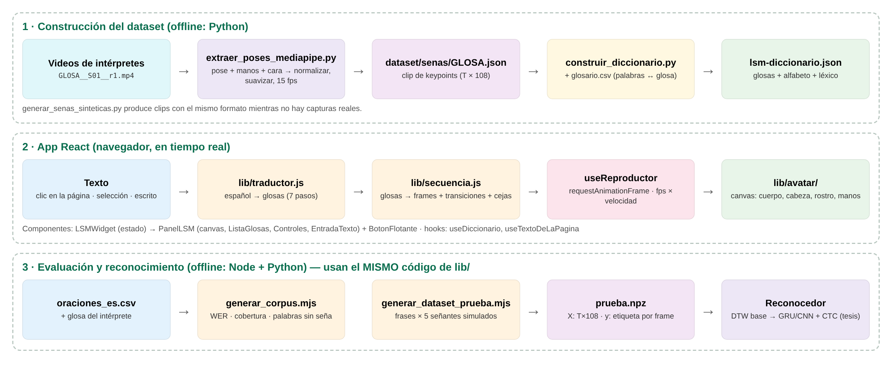

# lsm-avatar-dev — Traductor Español → LSM con avatar (React)

Prototipo de traductor automático de **español escrito** a **Lengua de Señas Mexicana (LSM)**
con un avatar 2D expresivo, inspirado en VLibras (Brasil). Hecho con **React + Vite**.

**Demo en línea:** https://marlon1117.github.io/Lsm-avatar-dev/ (funciona en iPad, celular y PC)

> ⚠ Las 75 señas incluidas son **sintéticas** (generadas por código) y **no están validadas**
> por la comunidad Sorda. El proyecto está preparado para reemplazarlas por capturas reales de
> intérpretes con MediaPipe.

## Diagrama del sistema



## Documentación

| Documento | Qué explica |
|---|---|
| [docs/ARQUITECTURA.md](docs/ARQUITECTURA.md) | Diagrama del sistema, flujo de datos, qué hace cada archivo de React |
| [docs/DATASET.md](docs/DATASET.md) | Cómo se genera el dataset (glosario, corpus, señas, dataset de prueba) y cómo se usa |
| [docs/AGREGAR_SENAS_Y_RECONOCIMIENTO.md](docs/AGREGAR_SENAS_Y_RECONOCIMIENTO.md) | Paso a paso para agregar señas, palabras, reglas y reconocimiento |

## Estructura

```
Lsm-avatar-dev/
├── app/                          ← Aplicación React (código fuente)
│   ├── src/
│   │   ├── lib/                  ← Lógica pura (sin React): la usan la app Y los scripts
│   │   │   ├── formato.js            Formato del frame (108 números)
│   │   │   ├── recursosLinguisticos.js  Listas de palabras y reglas del español
│   │   │   ├── traductor.js          Español → glosas
│   │   │   ├── secuencia.js          Glosas → secuencia continua de frames
│   │   │   └── avatar/               Dibujo del avatar en canvas (cuerpo, cabeza, rostro, manos)
│   │   ├── hooks/                ← Hooks de React
│   │   │   ├── useDiccionario.js     Descarga lsm-diccionario.json
│   │   │   ├── useReproductor.js     Animación con requestAnimationFrame
│   │   │   └── useTextoDeLaPagina.js Clic / selección sobre la página
│   │   ├── components/           ← Componentes de React
│   │   │   ├── LSMWidget.jsx         Componente principal (estado + composición)
│   │   │   ├── PanelLSM.jsx, BotonFlotante.jsx, ListaGlosas.jsx, Controles.jsx, EntradaTexto.jsx
│   │   ├── pages/PortalEjemplo.jsx   Página ficticia de prueba
│   │   ├── App.jsx, main.jsx         App de demostración
│   │   └── embed.jsx                 Widget de un solo <script> para cualquier página
│   └── public/lsm-diccionario.json   Diccionario generado (señas + léxico)
├── demo/                         ← App compilada (lo que publica GitHub Pages)
├── dataset/                      ← Datos: glosario, corpus, clips de señas, dataset de prueba
├── scripts/                      ← Generación del dataset (Python y Node)
└── docs/                         ← Documentación
```

## Ejecutar

```bash
cd app
npm install
npm run dev      # http://localhost:5173 con recarga automática
npm test         # pruebas del traductor y del secuenciador
npm run build    # compila en ../demo (GitHub Pages)
```

## Insertar el widget en cualquier página (como VLibras)

```html
<script charset="utf-8"
        src="https://marlon1117.github.io/Lsm-avatar-dev/demo/widget/lsm-widget.js"
        data-auto="true" data-color="#0b6e4f"></script>
```

## Regenerar el dataset

```bash
python scripts/generar_senas_sinteticas.py     # clips placeholder
python scripts/construir_diccionario.py        # → app/public/lsm-diccionario.json
node   scripts/generar_corpus.mjs              # corpus paralelo + métricas
node   scripts/generar_dataset_prueba.mjs      # dataset de prueba etiquetado
python scripts/cargar_dataset_prueba.py --npz  # → NumPy / .npz
python scripts/renderizar_video.py --ids F01_S01
python scripts/reconocedor_base_dtw.py         # reconocedor base (seña → glosa)
```

Desde el iPad: **Code → Codespaces → Create codespace** (el entorno ya trae Python, Node,
MediaPipe y ffmpeg; ver `.devcontainer/`).
