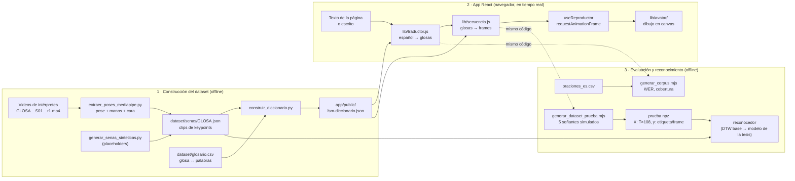
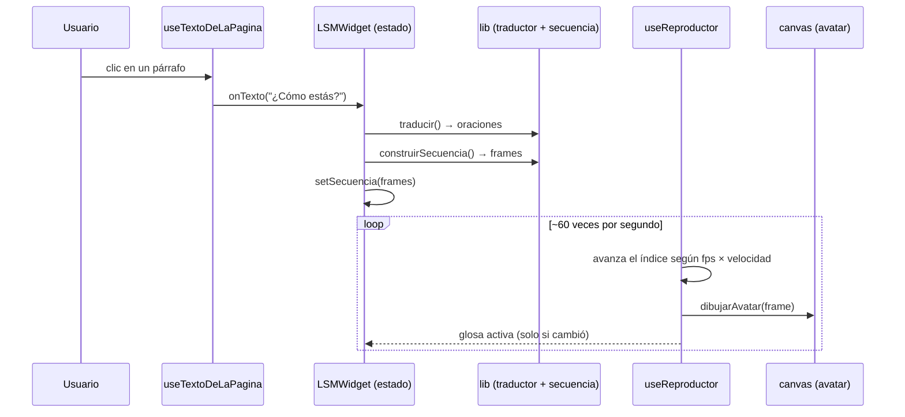

# Arquitectura del sistema

## Diagrama general

La idea central: **la lógica (`app/src/lib/`) no depende de React**. La app la usa para
animar el avatar y los scripts de Node la usan para generar el dataset. Así lo que ves en
pantalla y lo que se guarda en el dataset salen del mismo código.

## Flujo dentro de la app React

## Qué hace cada archivo

| Archivo | Tipo | Responsabilidad |
|---|---|---|
| `lib/formato.js` | lógica | Qué significa cada uno de los 108 números de un frame |
| `lib/recursosLinguisticos.js` | datos | Listas de palabras: multipalabra, palabras vacías, verbos irregulares… |
| `lib/traductor.js` | lógica | Español → tokens con glosas (7 pasos documentados en el archivo) |
| `lib/secuencia.js` | lógica | Une los clips, agrega transiciones, pausas y cejas de pregunta |
| `lib/avatar/*.js` | dibujo | Pinta un frame: cuerpo, cabeza, rostro (6 canales no manuales), manos |
| `hooks/useDiccionario.js` | hook | Descarga el JSON del diccionario |
| `hooks/useReproductor.js` | hook | Bucle de animación; dibuja sin re-renderizar React en cada frame |
| `hooks/useTextoDeLaPagina.js` | hook | Resalta y traduce texto de la página al tocarlo |
| `components/LSMWidget.jsx` | componente | Estado principal y composición del widget |
| `components/PanelLSM.jsx` | componente | Ventana: canvas, glosas, controles, entrada, aviso |
| `embed.jsx` | entrada | Monta el widget en un Shadow DOM para usarlo en cualquier sitio |

## Formato de un frame (108 números)

| Posiciones | Contenido |
|---|---|
| 0–17 | Pose superior: nariz, hombros, codos, muñecas, caderas (9 puntos × x,y) |
| 18–59 | Mano derecha del señante (21 puntos MediaPipe Hands) |
| 60–101 | Mano izquierda (21 puntos) |
| 102 | Cejas arriba (0–100) |
| 103 | Cejas fruncidas (0–100) |
| 104 | Boca abierta (0–100) |
| 105 | Sonrisa (−100 a 100) |
| 106 | Giro de cabeza (−100 a 100) |
| 107 | Asentir (−100 a 100) |

Coordenadas en 0–1000, eje *y* hacia abajo, `-1` = punto no detectado.
